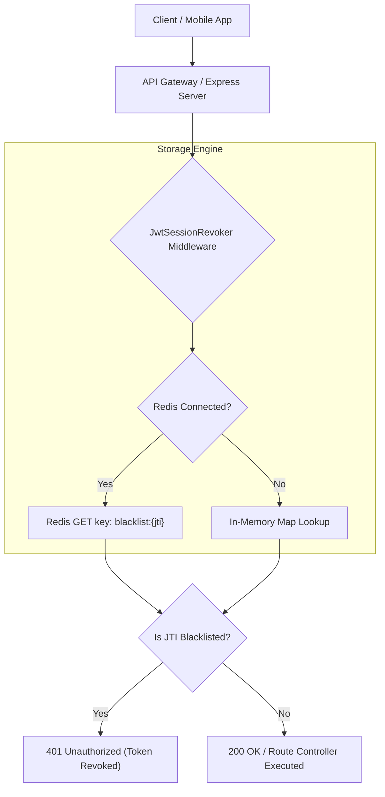
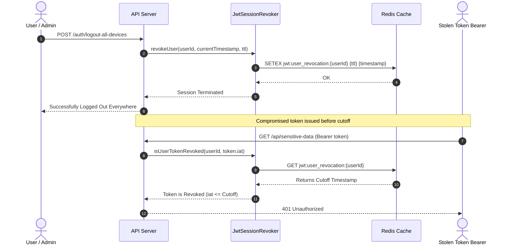

# 🔒 jwt-session-revoker

> **Topics:** `jwt` `session-revocation` `redis` `token-blacklist` `authentication` `api-security` `nodejs`


[](https://github.com/shadialhasan/jwt-session-revoker/releases/tag/v1.0.0)
[](https://github.com/shadialhasan/jwt-session-revoker/actions)
[](https://nodejs.org/)
[](LICENSE)
[](https://redis.io)

High-speed Redis-backed JWT token revocation, session blacklist, and multi-device instant logout middleware for Node.js microservices and API gateways. Eliminates the traditional security vulnerabilities of stateless JWTs during credential compromise, privilege changes, and explicit user logouts.

---

## 🌟 Key Features

- **Distributed Redis TTL Storage:** Revoked tokens automatically expire from the blacklist when their original TTL elapses, keeping memory footprints minimal.
- **In-Memory Fallback:** Seamless in-memory `Map` fallback with automated timer cleanup for local development, testing, and single-instance deployments.
- **Multi-Device Global Logout:** Instant invalidation of all existing sessions for a given user by setting a revocation timestamp boundary (`iat` validation).
- **Express & Fastify Middleware:** Ready-to-use middleware helper for protecting HTTP routes with zero boilerplate.
- **Sub-Millisecond Telemetry:** Built-in performance metrics tracking check latency, hit/miss ratios, and throughput.
- **Automated CI/CD:** GitHub Actions test pipeline verifying compatibility across Node 18, 20, and 22 with live Redis service containers.

---

## 🏗️ Architecture & Workflows

### Session Revocation Architecture



### Multi-Device Logout Sequence



---

## 🚀 Quick Start

### Installation

```bash
# Clone the repository
git clone https://github.com/shadialhasan/jwt-session-revoker.git
cd jwt-session-revoker

# Copy environment configuration
cp .env.example .env
```

### Basic Usage

```javascript
const JwtSessionRevoker = require('jwt-session-revoker');

// Initialize with in-memory storage (or pass a Redis client instance)
const revoker = new JwtSessionRevoker();

async function run() {
  const jti = "d3b07384-d113-46fb-a0ff-5c7a364be16a";

  // Revoke token for 1 hour (3600 seconds)
  await revoker.revokeToken(jti, 3600);

  // Check if token is revoked
  const isBlocked = await revoker.isRevoked(jti);
  console.log(`Is token blacklisted: ${isBlocked}`); // true
}

run();
```

### With Redis (ioredis / node-redis)

```javascript
const Redis = require('ioredis');
const JwtSessionRevoker = require('jwt-session-revoker');

const redis = new Redis({ host: process.env.REDIS_HOST, port: process.env.REDIS_PORT });
const revoker = new JwtSessionRevoker(redis, {
  defaultTtlSeconds: 3600,
  enablePerfLogging: true,
});
```

### Express Middleware Example

```javascript
const express = require('express');
const JwtSessionRevoker = require('jwt-session-revoker');

const app = express();
const revoker = new JwtSessionRevoker();

// Protect routes with revocation middleware
app.use('/api', revoker.createMiddleware((req) => req.user));

app.post('/auth/logout', async (req, res) => {
  await revoker.revokeToken(req.user.jti, 3600);
  res.json({ message: "Successfully logged out" });
});
```

---

## ⚙️ Configuration (`.env`)

```env
REDIS_HOST=127.0.0.1
REDIS_PORT=6379
REDIS_PASSWORD=
DEFAULT_TTL_SECONDS=3600
ENABLE_PERF_LOGGING=false
LOG_LEVEL=info
```

---

## 🧪 Automated Testing

The project uses Node.js native test runner (`node:test` and `node:assert`):

```bash
npm test
```

---

## 👤 Author & Maintainer

**Eng. MHD. Shadi AL-Hasan**  
- **Role:** Executive CTO & Enterprise Solutions Architect  
- **Email:** [mhd.shadi.alhasan@gmail.com](mailto:mhd.shadi.alhasan@gmail.com)  
- **Phone / WhatsApp:** [+963934005922](tel:+963934005922)  
- **Location:** Damascus, Syria  
- **GitHub:** [shadialhasan](https://github.com/shadialhasan)  

---

## 📄 License

This project is licensed under the MIT License - see the [LICENSE](LICENSE) file for details.  
Copyright (c) 2026 **MHD. Shadi AL-Hasan**. All rights reserved.